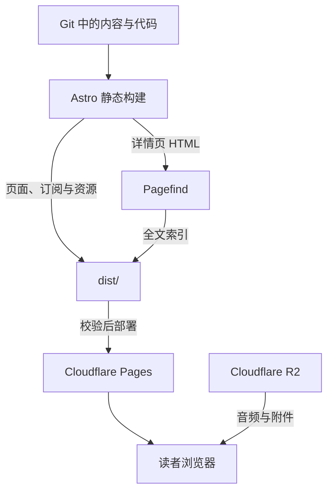

# linsto.org 架构

linsto.org 是单作者维护的 Astro 静态站点。Git 保存正文、元数据和发布状态。Node.js 运行作者工具和构建任务，Cloudflare Pages 向读者提供构建产物。

## 内容模型与地址

Astro 从 `content/` 加载五个集合。文字、声音和「此刻」按条目发布，`series` 保存节目资料，`pages` 保存「关于」页。站点设置和经典摘句直接读取 JSON。作者工具和构建共用 Zod 字段定义。[集合定义](../src/content.config.ts) · [字段定义](../src/lib/schemas.ts)

| 集合           | 公开地址           | 标识规则                                                                       |
| -------------- | ------------------ | ------------------------------------------------------------------------------ |
| 文字 `writing` | `/writing/<slug>/` | 目录名为 `YYYY-MM-DD-<slug>`，日期取自 `publishedAt`（`Asia/Shanghai` 时区）。 |
| 声音 `audio`   | `/audio/<slug>/`   | `uid` 在声音集合内唯一，用作 RSS 的 `<guid>`。                                 |
| 此刻 `now`     | `/now/YYYY/MM/`    | `period` 为 `YYYY-MM`，文件名为 `<period>.md`。`/now/` 展示最新可见月份。      |

文字和声音的集合内 ID 取自 `index.md` 所在的相对目录，公开地址使用各自集合内唯一的 `slug`。声音通过 `relatedWriting` 引用文章 `slug`。播客单集（`podcast`）必须填写 `series`，对应 `content/series/<series>.json`。独立录音（`recording`）须省略该字段。

## 发布规则

`publish:content` 更新本地内容文件。文字的新建和发布共用集合锁，发布日期改到另一天时，作者工具连同配图移动文章目录。[写入逻辑](../scripts/lib.mjs)

- **内容校验**覆盖草稿、未来条目和已发布条目。标识重复、文章目录或快照文件名不符、引用的节目或文章不存在，都会使构建失败。[跨条目校验](../src/lib/publication.ts)
- **生产可见性**由构建时刻决定。`draft` 默认是 `true`。每次生产构建复用同一份校验后的集合，选取 `draft: false` 且 `publishedAt` 已到的条目，供详情页、列表、RSS 和站点地图使用。定时条目在到期后重新构建并部署时上线。开发模式可以预览草稿和未来条目。[内容查询](../src/lib/content.ts)
- **声音订阅**只收录 `src`、`bytes`、`mime`、`duration` 齐全的可见条目。仅提供外部 `listen` 链接的单集仍有站内详情页。[声音 RSS](../src/pages/audio/rss.xml.ts)

## 页面与浏览器

`src/pages/` 定义路由，`src/layouts/` 和 `src/components/` 把导航、列表和正文写入 HTML。Markdown 在构建时转换。Rehype 插件为独占一段的图片生成放大入口，将图片标题用作图注。`prompted` 文章使用独立的 [PromptedArticle 布局](../src/layouts/PromptedArticle.astro)。Rehype 根据说话者标记分轮，并按 AI 回答的标题层级生成原生 `details`。[Markdown 配置](../astro.config.mjs)

全站样式集中在 `src/styles/`。Tailwind 提供布局工具类和断点，`tokens.css` 定义颜色、字体与阅读宽度，`markdown.css` 管理正文排版。页面和组件各自导入局部样式。折叠控件和图片弹窗由共享的 Astro 组件封装 Starwind Runtime。[样式入口](../src/styles/site.css) · [交互组件](../src/components/ui/)

Pagefind 索引详情正文、摘要、作者、对话助手与标签。分类和栏目筛选在索引内执行，浏览器通过 `entry_key` 筛选计数匹配列表行，并合并行内元数据的命中。开发模式或索引不可用时按行内元数据搜索。栏目链接使用节目 ID。[列表搜索](../src/scripts/collection.ts)

## 构建与交付

`pnpm build` 最后检查站内链接、资源和锚点，并确认搜索索引、订阅等文件齐全。GitHub Actions 保存校验后的 `dist/`，拉取请求的工作流到此结束。部署凭据齐全时，分支构建还会通过 Wrangler 将该目录上传到 Pages。`main` 对应生产环境，其余分支对应预览。[产物校验](../scripts/check-build.mjs) · [部署工作流](../.github/workflows/site.yml)

文章相对引用的本地图片由 Astro 优化，`public/` 下的文件原样发布。自托管音频和附件由作者工具上传 R2，对象键包含文件内容的 SHA-256。页面通过公开 URL 引用媒体，R2 对象独立于 Pages 部署。[媒体上传](../scripts/media.mjs)

canonical、RSS 和站点地图中的站内绝对地址使用 `content/settings/site.json` 的 `url`，构建时可用 `SITE_URL` 覆盖。写作命令和部署配置见[维护手册](maintenance.md)。
